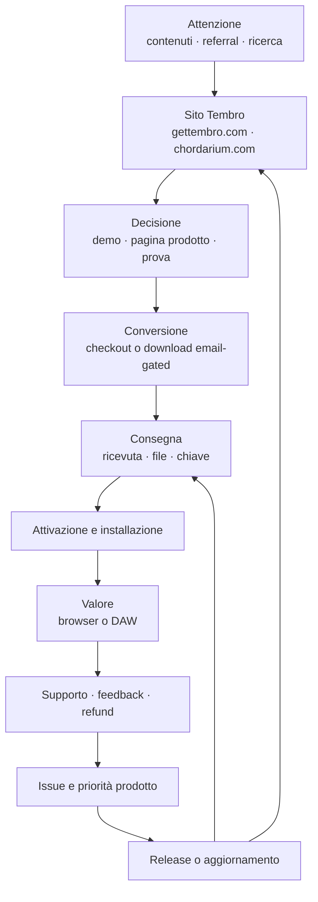
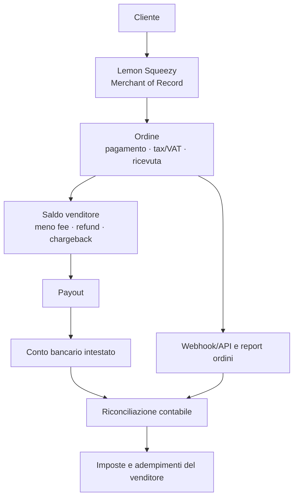
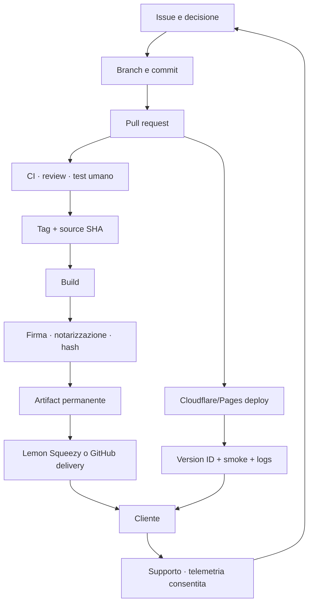

# Tembro Operating System

Stato del documento: **v0 — modello da completare**  
Ultima revisione strutturale: 12 settembre 2026

Questo documento descrive come Tembro crea valore, rilascia software e trasforma una
vendita in denaro riconciliato. Non contiene credenziali, dati personali dei clienti
o coordinate bancarie. Lo stato di lancio corrente vive nell'[issue #70](https://github.com/ste-hue/ableton-agent/issues/70);
le decisioni prodotto desiderate vivono in [`ops/products.json`](../ops/products.json).

## Regola del sistema

Ogni nodo operativo deve avere:

- un owner;
- una fonte di verità;
- un input e un output;
- un evento osservabile;
- un failure mode;
- una procedura di recovery;
- una metrica.

Se manca un elemento, scrivere **unknown**. Un riassunto chat è un handoff, non
un'evidenza.

## 1. Flusso di valore per il cliente

La conversione non è completata al pagamento. È completata quando il cliente
riceve l'artefatto previsto, lo installa, attiva la licenza e ottiene il risultato
promesso nel prodotto.

### Metriche minime

| Passaggio | Evento | Metrica |
| --- | --- | --- |
| Attenzione → sito | visita attribuibile | visite per canale |
| Sito → CTA | click canonico | CTR |
| CTA → ordine/download | checkout o lead completato | conversion rate |
| Ordine → installazione | file ricevuto e valido | delivery success |
| Installazione → valore | attivazione + primo export/uso | activation rate |
| Valore → supporto/refund | richiesta o rimborso | support/refund rate |
| Aggiornamento → adozione | nuova versione osservata | adoption rate |

Analytics e retention sono **unknown** finché non vengono scelti con una policy
privacy esplicita. Fa eccezione la landing Blocks, stato verificato il 2026-10-15:

| Strumento su `tembroaudio.com` | Stato | Prova |
| --- | --- | --- |
| Cloudflare Web Analytics | attivo, senza cookie, autorizzato 2026-09-26/27 | beacon nel HTML live |
| Meta Pixel | autorizzato 2026-10-15, **slot vuoto**: nessuno script Meta servito finché manca l'ID | `lib/tracking.ts` + HTML live senza `fbevents.js` |
| Click Buy → checkout | `gettembro.com/blocks/buy`, 302 verso il checkout Lemon Squeezy | `curl -I` |
| Ordine → sorgente | **non tracciata**: il checkout non porta `utm_*`/`fbclid` e la tabella ordini in D1 non ha colonne di sorgente | schema `orders` |

Il Pixel ID lo fornisce chi gestisce le inserzioni; non è un segreto. Il Pixel
imposta cookie di terze parti: il layout della landing non include un meccanismo di
consenso, da decidere prima di spendere traffico a pagamento.

## 2. Flusso del denaro e dei documenti

Lemon Squeezy dichiara di agire come Merchant of Record: è il venditore verso il
cliente e gestisce il pagamento, le imposte indirette della vendita, PCI, refund e
chargeback. Tembro deve comunque identificare correttamente il soggetto che riceve
il payout e gestire contabilità e imposte proprie. La conclusione fiscale dipende
da paese, residenza e soggetto giuridico e richiede un professionista competente.

Fonti operative correnti:

- [Lemon Squeezy — Merchant of Record](https://docs.lemonsqueezy.com/help/payments/merchant-of-record)
- [Lemon Squeezy — getting paid](https://docs.lemonsqueezy.com/help/getting-started/getting-paid)
- dashboard Lemon Squeezy per ordini, refund, fee, saldo e payout reali;
- estratto bancario per l'arrivo del netto;
- sistema del commercialista per la registrazione e gli adempimenti.

Non salvare importi cliente, email, chiavi, documenti fiscali o coordinate bancarie
nelle issue GitHub.

### Chiusura mensile minima

- [ ] Esportare ordini, refund e chargeback del periodo.
- [ ] Registrare fee e conversioni valutarie.
- [ ] Abbinare ogni payout alla relativa ricevuta/reverse invoice.
- [ ] Abbinare il netto all'entrata bancaria.
- [ ] Separare ricavo per prodotto, sconto e valuta.
- [ ] Registrare costi Apple, JUCE, domini, Cloudflare, API, supporto e strumenti.
- [ ] Segnalare differenze, payout pending e importi sotto soglia.
- [ ] Consegnare il pacchetto al sistema contabile/commercialista.
- [ ] Salvare solo link/ID non sensibili nel tracker operativo.

Cadenza, valuta di settlement, intestatario del payout e sistema contabile sono
attualmente **unknown**.

## 3. Flusso software, dati ed evidenza

### Fonte autorevole per dominio

| Dominio | Fonte autorevole | Prova minima |
| --- | --- | --- |
| Codice | `main` del repository prodotto | full commit SHA |
| Lavoro | issue + PR | URL e owner |
| Decisione prodotto | `ops/products.json` + decision log | review datata |
| Deploy Cloudflare | deployment/version + workflow run | ID + source SHA + smoke |
| Deploy Chordarium web | GitHub Pages workflow | run + commit + live marker |
| Binario | tag + artifact permanente | SHA-256 + firma/notarizzazione |
| File venduto | variante Lemon Squeezy | download da ordine + hash |
| Licenza | Lemon Squeezy license state/API | product/variant + test reale |
| Crediti web | D1 ledger | evento idempotente + riconciliazione |
| Incasso | ordine/payout LS + banca | payout ID + movimento abbinato |
| Stato globale | issue #70 | evidenza e una prossima azione |

## Confini per prodotto

| Prodotto/superficie | Codice | Delivery/runtime | Stato desiderato |
| --- | --- | --- | --- |
| Tembro umbrella/storefront | `ste-hue/ableton-agent` | Cloudflare `tembro-api` | catalogo e pagine prodotto |
| Tembro for Live | `ste-hue/ableton-agent` | LS + Worker/D1 | beta/credit packs |
| Atlas | `ste-hue/atlas` | LS email funnel + artifact multipiattaforma | free lead magnet |
| Chordarium browser | `ste-hue/ChordBloom-v1` | GitHub Pages | decisione demo/crediti pending |
| Chordarium plugin | `ste-hue/ChordBloom-v1` | LS file/licenza + DAW | macOS 0.2.0 launch target |
| Chordarium crediti legacy | `ChordBloom-v1/worker` | Worker + D1 separati | manuale/isolato |
| Rudiment | `ste-hue/rudiment` | nessuna delivery attiva | archived/coming soon |
| Rudiment Blocks plug-in | `ste-hue/tembro-blocks` | LS file/licenza + DAW | macOS 0.4.0, vedi `ops/products.json` |
| Rudiment Blocks landing (`tembroaudio.com`) | `ste-hue/rudiment-landing` | Cloudflare (vinext) + Worker/D1 per ordini | demo giocabile con un'unica uscita Buy, 89 EUR |
| Archivio release | `ste-hue/tembro-releases` | GitHub Releases | solo artifact intenzionali |

Non modellare Chordarium web, plugin, crediti legacy e pagina prodotto Tembro come
una singola “versione”: sono stream indipendenti che si incontrano nel customer
journey.

## Accesso e decision rights

| Tipo di lavoro | Collaboratore/agente | Stefano |
| --- | --- | --- |
| issue, branch, commit, PR | esegue | osserva/review |
| fix ordinaria con CI verde | può portare al merge secondo policy | escalation |
| prezzo/licenza/checkout | propone e documenta | decide |
| release/tag/artifact cliente | prepara evidenza | approva/pubblica |
| Cloudflare production/DNS/D1 | prepara workflow | approva/esegue gate |
| Lemon Squeezy/payout/banca | nessun accesso implicito | owner |
| legal/privacy/tax/IP | raccoglie fatti | decide con professionista |

Il percorso operativo del collaboratore è
[`docs/COLLABORATOR-QUICKSTART.md`](COLLABORATOR-QUICKSTART.md). Lo stato
dell'onboarding vive nell'[issue #72](https://github.com/ste-hue/ableton-agent/issues/72).

## Cadenza

- **Evento PR:** automazione su tutte le repository; segnala scope, CI, review e gate.
- **Giornaliero:** riconciliazione launch delle repository e superfici pubbliche.
- **Per deploy/release:** source SHA, run, version/tag, artifact hash e smoke test.
- **Mensile:** ordini → refund/fee → payout → banca → contabilità.
- **Trimestrale:** accessi, 2FA, secret, backup, costi, KPI e policy cliente.

Le automazioni osservano e riportano. Non prendono decisioni commerciali e non
superano gate umani.

## Decisioni aperte

### Esperienze interattive e protezione dei motori — 24 settembre 2026

Il [piano demo e plugin Tembro](strategy/2026-09-24-protected-plugin-demos.md)
definisce il percorso marketing → prova musicale → versione gratuita o acquisto
Lemon Squeezy, con generazione web privata e un rollout che parte da Rudiment.
Include il [contratto API proposto](strategy/demo-api-v1.md), verifiche, fallback
e decisioni ancora aperte. È una proposta di implementazione: non modifica lo
stato dei prodotti, i prezzi, le licenze o i sistemi in produzione descritti qui.

Le decisioni vanno chiuse nell'[issue Business OS #73](https://github.com/ste-hue/ableton-agent/issues/73):

- soggetto e paese che incassano oggi; paese previsto per Tembro;
- significato del riferimento Lemon Squeezy `104263`;
- demo Chordarium limitato versus prodotto web a crediti;
- “un anno” come scadenza d'uso oppure periodo di update/supporto;
- refund, EULA, privacy/telemetria e support SLA;
- costi ricorrenti e unit economics;
- sistema contabile e procedura di riconciliazione;
- diritti di distribuzione del corpus e base di licenza JUCE;
- consenso cookie per il Meta Pixel su `tembroaudio.com` (UE) e base giuridica;
- attribuzione degli ordini alla sorgente: portare `utm_*`/`fbclid` dal click Buy al checkout e al webhook, con migrazione D1 da applicare dall'owner;
- passaggio futuro da repository personali a GitHub Organization Tembro.
