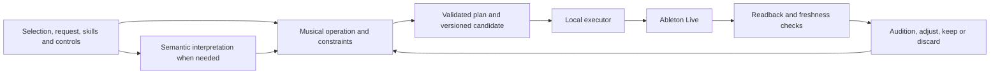

# ADR-0003 — Studio partnership and bounded musical interaction

- **Status:** Proposed
- **Date:** 2026-09-14
- **Deciders:** Stefano (owner), with Marco reviewing the interaction in Ableton.
- **Scope:** Tembro for Live in `ste-hue/ableton-agent`.
- **Related work:** [#89](https://github.com/ste-hue/ableton-agent/issues/89),
  [#86](https://github.com/ste-hue/ableton-agent/issues/86),
  [#83](https://github.com/ste-hue/ableton-agent/issues/83), and
  [draft PR #85](https://github.com/ste-hue/ableton-agent/pull/85).
- **Decision boundary:** This is an architecture proposal, not an implemented
  feature or a record of producer validation. Earlier ADRs retain their current
  status while this proposal is reviewed.

## Context

Stefano's September 14 discussion identifies the product problem: waiting for
the model can take longer than editing manually, and the eventual result can
feel arbitrary. He relays Marco's view that producers want to remain creative
and make their own choices. Tembro should help them experiment, learn from what
changes, and eventually recover the history of their work. These are founder
observations and product intentions, not completed usability research.

“Make this more interesting” has no universal musical answer. Its meaning
depends on the material, the session and the musician. Asking the founder to
define that answer in advance cannot settle the interaction design. We can
instead decide how the application develops an interpretation, exposes it to
the musician, and lets them steer or discard the result.

The inspected Mac checkout was `548ec01e8d0cf12b6ae221b65ff662acf365f1ed`:

- `lom_bridge.js` already reads selected track and highlighted clip slot into
  the context. This is not yet arbitrary note, time-range or Arrangement focus.
- `tembro_ui.html` exposes chat and skill selection. Its skill buttons dispatch
  chat requests; they are not deterministic musical controls.
- `agent_loop.js` runs a distributed model/tool loop. Its
  `tembro_arrange_clip` macro already expands one operation into sequential,
  verified local actions, providing a useful implementation precedent.
- PR #85 proposes opt-in latency instrumentation. At review time it is a draft,
  awaiting the full device suite and real Max/Ableton acceptance; its diagnostic
  files are absent from this checkout. It is not evidence of a speedup.

### Relationship to earlier decisions

On acceptance, this ADR supersedes only the following parts:

| Earlier record | Proposed replacement |
| --- | --- |
| [ADR-0001](0001-product-shape-and-monetization.md), Decision A: the drum library defines the product and the agent edits its output | Tembro is a studio partner. The library is one source of material; drums are a possible first delivery, not the limit of the interaction model. |
| [ADR-0002](0002-agent-architecture-and-interaction.md), Decision 1: the agent starts from a library result or selected clip | Interaction starts from an explicit musical target and context, including the musician's own material. Keep deterministic paths for supported controls. |
| ADR-0002, Decision 2.2: a fixed high-effort plan followed by low-effort model execution steps | Interpret intent when needed, then execute a validated musical operation locally. Choose model effort from measurements in separate implementation work. |
| ADR-0002, Decision 3: a fixed drum-first screen and three variations | Chat, skills and contextual controls share one interaction contract. Layout, candidate count and automatic audition are hypotheses to test. |
| [Product vision](../product-vision.md), the chat-only interface contract | Natural language is one way to act on the current music, alongside direct controls. |

Keep the existing commitments to bounded work, explicit completion and Live
readback. Commercial terms, onboarding, delivery infrastructure and other
products are outside this decision. The product vision's V1 memory sequencing
remains: personal musical intelligence follows observed use, rather than
becoming a prerequisite for the first useful interaction.

## Decision 1 — Preserve musical agency through an interaction contract

Tembro helps the musician explore a direction and retain authorship of the
choices. Its reliable promise is control over the experiment, not that one
interpretation of “interesting” is correct.

Every operation must identify its target, respect explicit constraints, expose
the intended change, and provide an honest recovery path. The musician's direct
edits remain authoritative. Musical suggestions are revisable; constraints
such as “keep the melody” are enforceable limits.

Use context to resolve ordinary references before asking questions. Separate
ambiguity about musical taste from ambiguity about what work may be touched:

| Situation | Proposed behavior |
| --- | --- |
| A supported, small change is explicitly requested on a clear target | Execute within the request after validation when a verified recovery path exists. Show the change and its undo/revert control; do not add a second approval ritual. |
| A clear target has an open creative request, such as “more interesting” | Make a bounded interpretation visible and offer a separate candidate or a small choice of directions. Let listening and adjustment develop the intent. |
| The target, protected material or required capability is unclear | Ask one question that resolves that uncertainty, or expose the missing selection. Do not guess a target to mutate. |
| A proposal expands scope, replaces protected work, or lacks reliable recovery | Present the concrete scope and consequence before applying it. If it cannot be performed reliably, report the limitation. |
| A provider action spends external credits, such as a Splice download | Follow that provider's explicit authorization contract. Approval of a musical idea does not silently authorize a purchase. |

The first row is a proposed policy, not permission to bypass the repository's
Live operating rules. Its eligibility boundaries need producer testing. Start
the first prototype with separate variants while recovery is being proven.

An inferred direction must not become a silent constraint or a remembered
preference. For example, “more interesting” might suggest changing accents in
one context and suggesting a different sound in another. This ADR defines
neither a fixed transformation nor permission to change the entire track.

## Decision 2 — Give language, skills and controls the same musical operations

Introduce the smallest shared contract needed for the first interaction,
following #86 and #89. Start with a selected MIDI clip and its operations;
extend the vocabulary when another use case requires it.

This is a conceptual contract, not a frozen wire format:

| Concept | Minimum responsibility |
| --- | --- |
| Target | Session-scoped object reference, captured selection, relevant region, and a way to detect replacement or content changes. Display names alone are insufficient. |
| Intent and constraints | Requested direction, explicit locks and allowed scope; retain which values the user supplied and which are interpretations. |
| Operation | Supported operation name/version, validated arguments, bounds and required adapter capabilities. Provider-specific paths stay in the adapter. |
| Proposal | Identity, source snapshot/revision, immutable candidate revision, affected objects, visible explanation, and available audition/recovery behavior. |
| Execution result | Verified changes and a truthful outcome: completed, partial, blocked, cancelled before application, or unknown pending reconciliation. |

The model may choose an operation, interpret intent or supply candidate material.
The executor validates the result and expands supported operations into local
calls. A button can construct the same operation directly. Controls on an
existing candidate use local transformations where those capabilities exist;
a control that requires new reasoning must show that it starts new work.

Skills contribute musical working methods, useful defaults and available
operations. They are not merely prompts behind buttons, and they do not grant
arbitrary execution privileges. “Less dense” must operate through the same
contract whether requested in chat or adjusted with a control.

Keep an operation's candidate payload and any random seed/version stable.
Accepting or repeating the same candidate must not silently regenerate it.
The first contract does not require a complete music ontology, a persistent
copy of the Live Set, a new database, or all planned adapters.

## Decision 3 — Make proposals, audition and application explicit states

A candidate can be prepared without changing the original. Audition may still
create a clip or change playback in Live; it is a real host operation with
ownership and cleanup obligations.

| Transition | Required behavior |
| --- | --- |
| Prepare → proposed | Capture the relevant original and candidate revision. Check constraints and describe what would change. |
| Proposed → auditioning | Use a supported preview path, preserve the original, and track any created objects or playback changes. Audition starts from a user action or a clearly enabled audition mode. |
| Proposed/auditioning → applying → accepted | Validate freshness and apply or retain the exact chosen revision. Mark accepted only after readback. If it was not auditioned, do not describe it as heard. |
| Proposed/auditioning → rejected | Discard the proposal and clean up only unchanged Tembro-owned preview work. Preserve the original and any intervening user work. |
| User adjusts a candidate → new revision | Treat the edit as authoritative, update the candidate and revalidate constraints. Accept acts on the current visible revision. |
| Relevant source or host state changes → stale | Invalidate the plan and re-inspect before another write. A changed selection does not silently redirect a pending operation. |
| Failure, stop or timeout during application → partial/unknown | Stop scheduling new work, reconcile observed host state, and report what remains. A stopped UI is not proof of cancellation or rollback. |

An original or candidate edited by the musician cannot be overwritten or removed
as routine preview cleanup. Restore playback only while the preview still owns
that transition; respect subsequent transport actions by the musician.

An explicitly requested direct edit uses the same operation and result records,
but can skip proposal review. Its recovery action must be demonstrated for that
operation. Do not assume a global `Song.undo` will undo exactly one Tembro change
after unrelated manual edits. If recovery or audition is unavailable, expose
that capability limit before application.

### Execution invariants

- Live is authoritative. Cached context is disposable; revalidate the target
  and relevant content before applying or accepting a proposal.
- A Set signature is not a note-content revision. MIDI operations require a
  fresh comparison of the relevant note data, including preserved attributes.
- Bind proposals to their source objects and session. An old track index must
  not resolve to a different track after deletion, insertion or a Set change.
- Preserve preflight, signature guards, sequential Live calls and readback from
  `AGENTS.md`. A compound local operation is not concurrent Live execution and
  does not authorize the forbidden `live_batch`, `live_exec` or `live_eval`.
- Bound planning and execution by time and operation count. Resolve sent-call
  timeouts using the existing bridge protocol; never blindly retry a mutation.
- Keep the reasoning/network path outside real-time audio execution. This ADR
  does not introduce a new audio callback or change Ableton's audio engine.

## Decision 4 — Measure useful feedback and earn musical memory

Optimize the time until the musician can make another useful musical choice.
A fast text response does not establish fast audition, and verified MIDI state
does not establish that anything was heard.

Build on PR #85's instrumentation after its remaining validation. Distinguish
context preparation, cloud round-trip wait, local execution, host-visible
readback and actual audition. Cloud wait is not a measurement of pure model
reasoning time. Record cold/warm conditions and launch quantization; an audible
result requires human observation or an appropriate audio capture, otherwise
label the available proxy.

Keep event records sufficient to recover this interaction: source and candidate
revisions, what changed, and explicit keep/discard/adjust outcomes. This is
session history, not a requirement to build the full long-term memory system.
Persisted preference learning, retention and cross-session retrieval remain
later decisions grounded in use. A rejection can mean poor timing or the wrong
context; it is not automatically a universal dislike. Ignored suggestions are
not explicit feedback.

Explanations should name the change and help the musician steer it. Keep facts
from Live, measured audio features and interpretations distinct. Statements
about brightness or sound require relevant audio evidence; the original source
file, a transformed clip and a rendered track are different analysis targets.

## Consequences

### First delivery and backlog order

Develop and validate on the Mac checkout through SSH from Tongfang. Application
acceptance takes place in Ableton on that Mac, using the repository's disposable
Set and single-driver rules. This draft itself changes documentation only.

| Work | Bounded next increment |
| --- | --- |
| #83 / PR #85 | Complete the existing diagnostic validation and collect a baseline. Choose optimizations from those measurements. |
| #89 + a subset of #86 | Implement one complete selected-clip interaction: capture → candidate → audition/adjust → keep/discard → verified state. Add only the object contracts it uses. |
| #87 | When an audio workflow needs it, add typed local file transforms with validated artifacts. Source preservation and source/region identity follow the same proposal contract. |
| #88 | Add evidence from a clearly identified audio region or render; distinguish source-file analysis from what Live actually plays. |
| #84 | Reuse the existing provider work for contextual sample candidates, with explicit credit-spending downloads and the same audition/selection contract. |

These issues remain separate and open until their own acceptance criteria are
met. A documentation proposal or a single MIDI interaction does not complete
them. No new duplicate latency or Splice implementation is needed for this ADR.

**Proposed first experiment:** on a selected Session MIDI drum clip, request
“less busy hats; keep kick and snare,” then adjust the resulting variation.
Show the target and locks, create a candidate in a verified free slot, and
offer audition plus keep/discard. Resolve roles from a verified kit mapping;
do not assume General MIDI note numbers fit the current Drum Rack. Missing
role information must be resolved before editing.

For this prototype, Keep retains the candidate as a separate clip and identifies
it as the chosen version; replacing the source is a separate action. Discard
removes only an unchanged, owned preview. The hi-hat task is a test fixture for
the interaction, not a claim that it is the product's winning use case.

Before calling that delivery complete, demonstrate:

1. The source is unchanged; locked kick/snare notes and their relevant
   attributes match in the candidate. Scope and length constraints hold.
2. Keep retains the exact current candidate. Discard leaves source and
   unrelated user work intact; both transitions are verified in Live.
3. Manual source edits, note-only edits, candidate edits, selection movement
   and Set changes produce the defined revision/staleness behavior.
4. Stop, timeout and partial application preserve evidence of what happened
   and do not trigger duplicate writes or blind rollback.
5. Audition and the supported recovery action work in the real host, including
   intervening manual edits. State checks and listening results are reported
   separately.
6. Marco can compare the flow with his manual workflow on his own material,
   steer it and explain whether he wants another iteration. Technical success
   alone is not evidence of creative value.

This approach adds proposal state, source preservation and recovery work before
expanding the operation catalogue. Adapter capability limits become visible
product decisions. The payoff to test is a shorter path from an unclear idea
to an experiment the musician controls.

## Open questions — hypotheses to test

These are proposed experiments, not accepted UX facts or measured performance:

| Hypothesis | Evidence that would change the design |
| --- | --- |
| A separate, immediately adjustable candidate is a useful default for vague requests | Marco repeatedly prefers direct editing with reliable undo, or finds the extra clips disruptive. Compare both behaviors before widening direct-edit eligibility. |
| One initial candidate plus controls is enough to start | Musicians need several simultaneous directions to choose meaningfully. Candidate count and layout stay open. |
| The hat-variation task exposes the important friction | Real session examples reveal a more valuable first operation, such as sound choice or arrangement. Keep the contract and change the test case. |
| Explicit audition is a workable initial policy | Deliberately enabled automatic audition improves flow without surprising playback changes. Test this in context. |
| Useful provisional timing goals are 100 ms for acknowledgement, 1 s for a warm local candidate to be ready, and 5 s for a first semantic candidate | These are internal design targets chosen on 2026-09-14, not external benchmarks or measured capability. Measure achieved distributions, playback delay and willingness to continue; revise operation scope or routing from the results. |
| Session history creates value before persistent taste inference | Producers ask to retrieve past work or repeat preferences often enough to justify a specific cross-session memory feature. |

Stefano owns implementation feasibility and instrumentation. Marco reviews
behavior using actual musical material. Record observed sessions and resulting
decisions alongside the implementation PR; do not turn a single taste judgment
into a universal product rule.

## Sources

- Stefano's product discussion, 2026-09-14: preserve creative ownership, reduce
  waiting, combine natural language with plugin controls, and develop memory.
  Marco's views above were relayed by Stefano; no direct test is claimed.
- Mac source baseline `548ec01e8d0cf12b6ae221b65ff662acf365f1ed`, inspected
  2026-09-14: [context and selection](../../devices/Tembro/code/lom_bridge.js),
  [agent execution](../../devices/Tembro/code/agent_loop.js),
  [device entry point](../../devices/Tembro/code/tembro_main.js),
  [current UI](../../devices/Tembro/tembro_ui.html),
  [operating rules](../../AGENTS.md), and
  [collaboration contract](../../.agents/COLLABORATION.md).
- [ADR-0001](0001-product-shape-and-monetization.md),
  [ADR-0002](0002-agent-architecture-and-interaction.md), and
  [product vision](../product-vision.md), read at that same baseline.
- Issues [#83](https://github.com/ste-hue/ableton-agent/issues/83),
  [#84](https://github.com/ste-hue/ableton-agent/issues/84),
  [#86](https://github.com/ste-hue/ableton-agent/issues/86),
  [#87](https://github.com/ste-hue/ableton-agent/issues/87),
  [#88](https://github.com/ste-hue/ableton-agent/issues/88), and
  [#89](https://github.com/ste-hue/ableton-agent/issues/89), read 2026-09-14.
- [PR #85](https://github.com/ste-hue/ableton-agent/pull/85), draft head
  `9c6caa325a4761a8b0a1537549018b71d27d890a`, read 2026-09-14. The baseline
  measurement and real-host acceptance remain outstanding.
