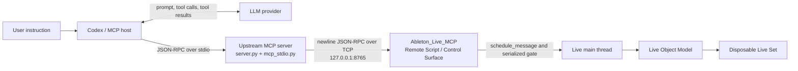

# Ableton Agent architecture

Status: approved discovery design, 2026-08-26

## Decision

The first product question is deliberately narrow:

> Can an existing MCP-capable LLM inspect and safely control Ableton Live through the proven `ableton-live-mcp` integration?

The first proof uses Codex as the local MCP host because it is already installed on this Mac and this repository is trusted. The architecture remains MCP-client-neutral so another compatible host can replace Codex without changing the Ableton side.

We will not build a custom chat interface, a browser connector, a Max for Live UI, or a Chordarium integration until this proof passes against real Ableton Live.

## Goals

- Reuse `bschoepke/ableton-live-mcp`; do not rebuild or vendor its bridge.
- Let an LLM discover a small approved tool surface through MCP and use it from a natural-language instruction.
- Prove a complete read/write/read/play/stop/undo path against a disposable Live Set.
- Keep this repository limited to dependency metadata, MCP-host configuration, validation code, evidence, and documentation.
- Make every mutation reviewable and every acceptance claim observable.

## Non-goals

- A commercial or distributable product.
- A project-owned Ableton Remote Script or raw TCP bridge.
- A custom LLM chat application or direct OpenAI API integration.
- Chordarium, MIDI-file transfer, browser-to-localhost transport, or credit behavior.
- Max for Live devices or UI.
- MPE, audio, devices, plugins, Arrangement editing, or arbitrary Python execution in Live.
- Compatibility claims beyond the exact Live and upstream versions tested.

## Evidence baseline

| Item | Observed state |
| --- | --- |
| Project repository | Empty Git repository before these documents; no remote and no commits. |
| Upstream | `https://github.com/bschoepke/ableton-live-mcp`, commit `70f7df9192b78d9bd9405f369c9e046c88f1610e` (2026-07-24), distribution version `0.1.1`, no tags. |
| Upstream inspection | External temporary clone outside this repository; no upstream source copied here. |
| Upstream tests | 285 collected. With a writable isolated state directory, 266 non-validation tests passed and 19 validation tests were deselected. The full run reached 269 passes and 16 validation failures caused by the unavailable macOS Quartz dependency. |
| Real-Live coverage | None. The upstream suite uses a fake `Live` model for bridge tests; it does not replace the real-Live acceptance run. |
| Ableton Live | Not found in `/Applications`, the user Applications directory, Spotlight metadata, package receipts, expected User Library paths, or as a listener on port 8765. |
| Mac | Apple M2 Max, arm64, macOS 26.3.1, 64 GB RAM, sufficient free disk space. |
| Python | System Python 3.9 is too old for upstream (`>=3.10`). Homebrew Python 3.12 is available and is the proposed runtime. |
| MCP hosts | Codex, Claude, Cursor, and ChatGPT are installed. Codex is the primary validation host. |

The upstream pin is a source commit, not the package version. `0.1.1` alone is not reproducible because the inspected repository has no release tag at that commit.

## System architecture



### 1. LLM host

Codex starts one long-lived upstream MCP process as a local STDIO server. Project-scoped configuration will live in `.codex/config.toml`, not in the user's global configuration. Official Codex configuration supports project-scoped MCP servers for trusted projects, STDIO commands, tool allowlists, and per-server approval modes.

The host is responsible for:

- presenting MCP tools to the model;
- asking the user to approve every tool call during the first proof;
- retaining the natural-language request and tool-call transcript as evidence;
- exposing only the milestone's required upstream tools.

The host is not responsible for speaking directly to port 8765 or implementing Live semantics.

The model provider is a separate external trust boundary. Set names, track names, clip metadata, note data, and tool results selected as context can leave the Mac for model processing. The first proof therefore uses only a new disposable Set containing the fixed test fixture.

### 2. Upstream MCP server

The active package entry point is `ableton-live-mcp = server:main`. `src/server.py` imports `src/mcp_stdio.py`; `src/mcp.py` is not the active server implementation.

The MCP server:

- advertises tools and JSON Schemas through MCP;
- serializes MCP messages over standard input/output;
- forwards tool calls to its `AbletonBridgeClient`;
- owns bridge connection, idle reconnect, response limits, and timeout behavior.

Our code must use this process boundary. It must not import upstream's internal Python modules as an application API.

### 3. Localhost bridge

The Python bridge client sends newline-delimited JSON-RPC to `127.0.0.1:8765`. Defaults at the pinned commit include a 30-second request timeout, 2-second connect timeout, 8-second idle timeout, and 8 MiB maximum response.

The connection is local only, but it is not authenticated. Any local process that can reach port 8765 could attempt bridge calls while the Remote Script is active. The port must never be exposed on `0.0.0.0`, proxied, or opened to a browser or network in this milestone.

### 4. Ableton Remote Script

`Ableton_Live_MCP` is installed as a third-party Control Surface. Its TCP listener accepts at most 1 MiB per request and dispatches Live Object Model work onto Live's main thread with `schedule_message(0, ...)`.

A bounded semaphore permits only one main-thread Live request at a time. The application and the LLM must therefore make Live API calls sequentially. Parallel reads or writes are outside the supported contract.

### 5. Live Object Model

The Remote Script resolves canonical paths such as:

```text
live_set
live_set tracks 2
live_set tracks 2 clip_slots 0
live_set tracks 2 clip_slots 0 clip
```

Paths are rediscovered after mutations. Numeric object IDs returned by the bridge are not persisted because object references can become stale when the Set changes.

Ableton Live is the authoritative state. Neither an MCP success response nor the LLM's prose is accepted without reading the affected Live object back.

## Ownership boundaries

| Owner | Responsibility |
| --- | --- |
| This repository | Dependency pin, project-scoped MCP policy, deterministic acceptance fixture, validation procedure, and evidence. |
| Upstream | MCP STDIO server, TCP client, localhost protocol, Remote Script, and Live Object Model mapping. |
| Codex host | Model orchestration, MCP subprocess lifecycle, tool visibility, approvals, and transcript. |
| LLM provider | Model inference over the prompt and selected tool context. |
| Ableton Live | Authoritative Live Set state and undo history. |

## Dependency strategy

The durable dependency will be installed in a project-local Python 3.12 virtual environment from the upstream Git URL pinned to the full commit SHA. The repository will record at least:

- repository URL;
- full commit SHA;
- observed distribution version;
- expected console command;
- required MCP tools.

The upstream executable will be referenced by absolute path from the project-scoped MCP configuration. The upstream repository itself remains external.

The pinned dependency is MIT-licensed. An upstream upgrade is deliberate: select a new full SHA, inspect its diff and tool schemas, run its offline tests, reinstall the Remote Script from that same package, authorize a Live/Control Surface reload, verify runtime hash parity, and repeat the entire real-Live acceptance run.

Alternatives rejected for this phase:

- **Copying source:** duplicates infrastructure and obscures upstream provenance.
- **Git submodule:** useful only if local upstream patching becomes necessary; it adds source and submodule workflow before there is evidence of a gap.
- **Sibling clone as the runtime contract:** convenient for inspection but weaker for reproducible setup.
- **Fork:** justified only after a concrete required capability or compatibility fix cannot be accepted upstream.
- **Calling port 8765 directly:** bypasses the MCP server's schemas, instructions, connection handling, and timeout policy.
- **Building a custom chat app:** adds an LLM API and UI without improving the Ableton bridge proof.

## First-proof tool surface

Codex will expose only these upstream tools:

| Tool | Purpose in the proof |
| --- | --- |
| `live_ping` | Confirm Live and the loaded Remote Script respond. |
| `live_bridge_status` | Inspect socket-thread health without scheduling a Live main-thread call. |
| `live_get` | Read specific state such as `can_undo` and clip playback properties. |
| `live_set_summary` | Read the Set, discover paths, and obtain `set_signature`. |
| `live_set` | Name the newly created track. |
| `live_call` | Call only `create_midi_track`, clip-slot `fire`/`stop`, and Song `undo` during this proof. |
| `live_clip_add_notes` | Create the Session clip and insert typed MIDI notes. |
| `live_clip_notes` | Read notes using Live's extended MIDI-note API. |
| `live_transport` | Read, start if required, and stop the transport. |

`live_call` is broader than the methods needed here, so a tool allowlist alone cannot enforce method-level safety. Every call stays in approval mode, and the human must verify its object path, method, and arguments before approval.

The following powerful upstream tools are deliberately unavailable: `live_exec`, `live_eval`, `live_batch`, browser loading, device insertion, audio tap, visual capture, and every Max for Live tool.

## Reliability rules

### Runtime parity is a mutation gate

Before any mutation, upstream validation must report both:

```json
{
  "runtime_current": true,
  "live_mutations_safe": true
}
```

These fields prove that the installed and currently loaded Remote Script fingerprints match the pinned package. A successful socket connection alone is insufficient.

### Inspect before each mutation

`live_set_summary` returns a `set_signature`. Mutating calls use the latest signature through `expected_set_signature`. Because each persistent mutation can change the signature, the Set is read again before the next mutation.

This is optimistic concurrency protection, not a transaction. It detects a Set changed since inspection; it cannot roll back a partially completed sequence.

The current signature covers Set topology and selected clip metadata but not MIDI note contents. It cannot replace the exact `live_clip_notes` readback.

### Sent-call timeouts have unknown outcomes

If a bridge request times out after it was sent, the mutation may still have happened inside Live. The upstream client intentionally does not retry it.

After such a timeout:

1. do not resend the mutation;
2. call `live_bridge_status` only;
3. wait for the documented cooldown or recover Live with explicit user authorization;
4. re-read the Set and target object;
5. classify the operation as applied, not applied, or still unknown.

There is a narrower residual upstream risk: the Python client retries a generic socket `OSError` once, and not every `OSError` proves the connection failed before `sendall()`. A connection reset after send could therefore duplicate a mutation. The disposable fixture and mandatory readbacks make that visible, but this architecture does not claim exactly-once delivery. A real occurrence becomes evidence for an upstream fix or project-owned narrow adapter.

### No parallel Live calls

All Live calls are sequential. The Remote Script rejects another main-thread request while one is in flight, and a timed-out main-thread request triggers a cooldown.

### Modals and UI stalls are blockers

A Live warning, save dialog, crash dialog, or unresponsive UI invalidates the run. The LLM must not click through, restart Live, reload the Control Surface, close a Set, or discard changes without explicit authorization.

`live_bridge_status` reports the Remote Script's socket-thread health without scheduling the Live main thread. It does not prove that the Live UI or main thread is healthy.

## Acceptance-test state model

The first proof runs only in a new, unsaved, disposable 4/4 Live Set. The LLM records the initial summary and never targets an existing user track or clip.

The deterministic MIDI fixture is:

```json
{
  "track_name": "Agent Test",
  "clip_name": "Agent Test - C minor",
  "clip_length_beats": 16.0,
  "notes": [
    {"pitch": 60, "start_time": 0.0, "duration": 16.0, "velocity": 100, "mute": false},
    {"pitch": 63, "start_time": 0.0, "duration": 16.0, "velocity": 100, "mute": false},
    {"pitch": 67, "start_time": 0.0, "duration": 16.0, "velocity": 100, "mute": false}
  ]
}
```

At 4/4, 16 quarter-note beats are four bars. Pitch 60 is the MIDI note normally called middle C; Ableton's displayed octave label may differ, so validation compares MIDI pitch numbers rather than note-name strings.

`undo` means one call to `Song.undo()` followed by observation of the actual last-operation reversal. The upstream sequence is not transactional, so this criterion does not assume that one undo removes the track, name, clip, and notes together. Cleanup is closing the disposable Set without saving, performed only with user authorization.

## Deferred architecture

Only after the real-Live proof passes will we reconsider, in order:

1. a project-owned narrow adapter with method-level policy;
2. deterministic Chordarium event transfer without an LLM in the MIDI path;
3. a custom chat experience;
4. a Max for Live chat UI.

None of those future designs is a dependency of the first proof.

## Primary references

- [Pinned upstream source](https://github.com/bschoepke/ableton-live-mcp/tree/70f7df9192b78d9bd9405f369c9e046c88f1610e)
- [Upstream MCP tool registration](https://github.com/bschoepke/ableton-live-mcp/blob/70f7df9192b78d9bd9405f369c9e046c88f1610e/src/server.py)
- [Upstream Python bridge client](https://github.com/bschoepke/ableton-live-mcp/blob/70f7df9192b78d9bd9405f369c9e046c88f1610e/src/bridge.py)
- [Upstream Ableton Remote Script bridge](https://github.com/bschoepke/ableton-live-mcp/blob/70f7df9192b78d9bd9405f369c9e046c88f1610e/Ableton_Live_MCP/bridge.py)
- [Official Codex MCP configuration](https://developers.openai.com/codex/mcp)
- [Official Live Object Model: Song](https://docs.cycling74.com/apiref/lom/song/)
- [Official Live Object Model: Clip](https://docs.cycling74.com/apiref/lom/clip/)
- [Official Live Object Model: ClipSlot](https://docs.cycling74.com/apiref/lom/clipslot/)
