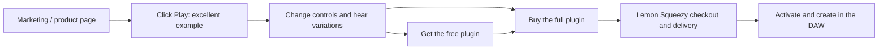
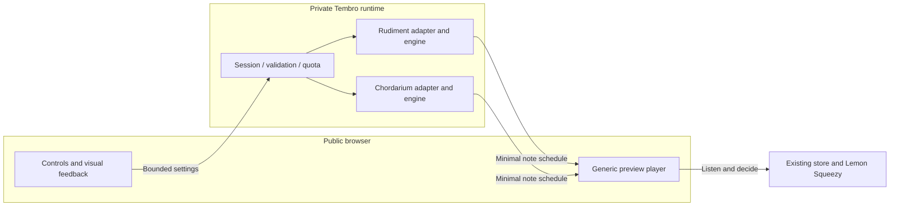

# Tembro: experience the music, then buy the plugin

Date: 2026-09-24. Status: implementation proposal; no deployment or commercial changes.
Product owner: Stefano. Musical acceptance: Stefano with the product's musical owner.
Related work: [Business OS #73](https://github.com/ste-hue/ableton-agent/issues/73),
[launch control #70](https://github.com/ste-hue/ableton-agent/issues/70),
[product engines / pack #90](https://github.com/ste-hue/ableton-agent/issues/90).

## Decision

Build a reusable interactive demo journey across Tembro products. Visitors hear a
strong result immediately, explore a meaningful selection of controls, and buy the
plugin through the existing Lemon Squeezy flow. Proprietary web generation executes
on Tembro's server. The browser receives controls, playback code, and bounded musical
results, not the full composer or its private datasets.

Deliver this first for Rudiment, then extend the shared delivery pattern to
Chordarium. Keep their musical engines independent. Other plugins join only when
their capabilities and release readiness are established. A shared platform does
not require one universal musical engine or a rewrite of every repository.

This protects the implementation from direct browser downloads. It cannot make
audible output unrecordable, make returned notes secret, prevent all behavioral
imitation, or make an offline plugin impossible to reverse engineer.

## The customer's journey

First play needs no account. A curated example can start playback while a protected
generation session is established. Generation is an explicit action, rather than
an API request on every slider movement. Keep the result playing while a variation
is prepared; apply it at a musical boundary. Show the paid value beside the demo:
working in the DAW, deeper composition controls, project recall, and supported
export/integration features. Advertise only capabilities verified for that product.

Do not deliberately worsen musical quality in free experiences. Limit scope,
variety, integration, and usage instead. The demo must demonstrate the quality that
the customer is buying.

| Experience | Proposed value | Boundary |
| --- | --- | --- |
| Browser demo | Immediate playback, selected styles and useful controls, short generated variations | Private generation API; no project-download or DAW-sync UI; returned notes remain extractable |
| Free downloadable plugin | A useful, honest subset that can introduce the DAW workflow | Offline versus online generation is an open owner decision; do not ship the full paid engine behind a UI flag and call it protected |
| Paid plugin | Full product workflow, supported export/sync/recall, broader musical capabilities | Preserve existing customers' offline behavior and license terms; client-delivered code remains inspectable |

Planning assumption while the free-plugin decision is open: a genuinely smaller
offline edition or curated content pack. Its build must omit paid-only algorithms
and datasets. If meaningful offline generation requires the same secret algorithm,
choose either online generation or explicitly accept that exposure. A smaller UI
does not create a smaller engine.

Prices, free download gating, feature allocations, renewal terms, and new Lemon
Squeezy variants remain undecided. Do not alter existing purchases to fit this plan.

## Use the existing ecosystem

| Surface | Role in this plan |
| --- | --- |
| `gettembro.com` / `ste-hue/ableton-agent` | Existing marketplace, product destinations, checkout routing and central operational records |
| `tembroaudio.com` / `ste-hue/rudiment-landing` | Rudiment's dedicated funnel, as requested; design remains pending |
| `chordarium.com` / `ste-hue/ChordBloom-v1` | Existing limited demo; retain it until a replacement earns release readiness |
| `rudiment.gettembro.com` / Worker `rudiment-site` | Currently exposed development app; first containment target |
| `ste-hue/rudiment` | Canonical Rudiment engine and plugin source |
| Lemon Squeezy | Existing checkout, purchased downloads and product licenses |

This plan lives in the central repository. Do not create another catalogue, an
independent billing system, or separate account systems for every product.
Use a shared demo contract with product-specific adapters. Keep engine services
separate from the existing storefront/credit ledger deployment.

## Evidence and consequences

Source snapshots reviewed on 2026-09-24:

| Repository | Main revision |
| --- | --- |
| `ste-hue/ableton-agent` | `548ec01e8d0cf12b6ae221b65ff662acf365f1ed` |
| `ste-hue/rudiment` | `2463c2112fcb8737d7f0f52243c8aec7d6d2f0db` |
| `ste-hue/ChordBloom-v1` | `9551df98030260188b728e1bf8915ad145dabb15` |

- **Rudiment exposure confirmed:** unauthenticated requests to the live app and
  `src/engine/arrangement-engine.js?v=10` and
  `src/engine/drum-machine-theory-engine.js?v=1` returned HTTP 200 and actual
  JavaScript. These observations concern the deployed build, not a claim that
  every current-main file is public. There is no evidence of theft in this audit.
  Worker `workers.dev` and version-preview access were observed disabled.
- **Chordarium already has an effective separation:** the live page identifies
  five curated seeds. The public build replaces the composer with recorded outputs;
  reviewed engine/catalogue markers were absent. Some playback code and example
  material are necessarily public. Keep `scripts/demo.js` and `tests/demo.test.js`
  as the existing baseline, not a guarantee about every historical deployment.
- **Rudiment's adapter needs care:** `test/harness.js` loads ordered classic scripts,
  mutates `cfg`, and calls `generate()`. Its Node `vm` harness is a test mechanism,
  not a ready Cloudflare implementation. The server adapter must isolate mutable
  configuration and random state between requests.
- **One source is deliberate:** Rudiment ADR 0002 and ADR 0005 keep the engine in
  JavaScript with deterministic golden tests. Preserve this decision for the first
  server release. A native-engine port requires a separate architecture decision,
  parity evidence, and ownership agreement.
- **Commerce is partially reusable:** `server/src/billing.ts` contains Lemon
  Squeezy signature verification and license activation/validation. Its credit
  grant logic serves existing credit packs; it is not a general plugin entitlement
  system. Reuse audited mechanisms without reusing credit balances as demo quotas.
- **Recorded desired state is stale:** `ops/products.json` still marks Rudiment
  archived/coming soon, while current source and a live app were observed. Reconcile
  that record in a separate reviewed change; do not invent a checkout or release.
  The earlier integration described in #90 is a separate branch and must be
  compared before creating another engine adapter.

## Private generation architecture

Start by evaluating Cloudflare Workers for the existing JavaScript generation
engines. Benchmark actual Worker CPU, memory, concurrency, and response latency;
Node timings alone do not establish deployment fitness. Keep audio synthesis and
sample-accurate scheduling local in the browser. Network calls create the next
phrase, never schedule individual beats. If generation exceeds the measured
budget, shrink the demo workload or use a private backend suited to it, without
changing the browser contract. Do not add audio rendering infrastructure initially.

The server owns composition, voicing, arrangement, fill selection, musical
humanization rules, and the private datasets used to choose results. The browser
owns generic playback, already-generated note visualization, and public controls.
Audit dependencies: a preview helper can also contain proprietary musical rules.

Build server artifacts from one pinned canonical engine source. Do not maintain a
second manually copied engine. Use a build-time adapter with an explicit script
order and isolated per-request state; never accept executable code or source URLs
from a visitor. Run canonical fixtures against both adapters. Pin the engine
revision internally so a rollout can restore the same behavior.

Prefer a first-party demo host with a same-origin API. Other product pages link to
it initially, avoiding dependence on cross-site cookies. If embedding is later
useful, test browser storage restrictions and explicitly secure the message bridge.
No hostname or route is provisioned by this document. See the
[API contract](demo-api-v1.md) for proposed endpoints and failure behavior.

## Controls proportional to the risk

1. **Protect artifacts first.** Build public assets from an explicit allowlist.
   Inspect the emitted HTML, JavaScript, lazy chunks, maps, examples and downloadable
   archives. Reject private engine code, full datasets, native bundles, secrets,
   and repository metadata. Minification, Wasm, encryption whose key is shipped to
   the browser, CORS, and hidden export buttons are not confidentiality boundaries.
2. **Make harvesting more expensive.** Validate Turnstile on the server when
   issuing a short session; enforce allowed host/action, bounded inputs, generation
   frequency, concurrency, and session usage. Anonymous sessions can be renewed by
   an attacker: no anonymous quota is a reliable per-person limit. Increase friction
   on suspicious activity without requiring registration before first play.
3. **Bound cost independently.** Edge rate limits reduce bursts but are approximate.
   Use authoritative atomic accounting for session allowances and a global daily
   generation ceiling. A Durable Object is a candidate, with concurrency tests
   before launch. Reserve allowance before computation. Cap CPU, output size and
   in-flight work; provide an immediate generation kill switch and a static fallback.
   This bounds generation work, not every possible infrastructure charge.
4. **Keep secrets and operational data private.** No provider keys or full-license
   values in frontend bundles, URLs, logs, or analytics. Scope server credentials
   to their service. Log versions, timings, request IDs and error codes; avoid
   raw musical projects, customer emails and full request bodies by default.

Cloudflare requires server-side Turnstile validation; tokens expire after five
minutes and are single-use. Exchange a valid token for a session instead of
reusing it for each generation. [Turnstile validation](https://developers.cloudflare.com/turnstile/get-started/server-side-validation/)

Workers rate-limit counters are eventually consistent and are not an accounting
system. Benchmark against current runtime limits before selecting a plan or
promising cost. [Rate limiting](https://developers.cloudflare.com/workers/runtime-apis/bindings/rate-limit/),
[runtime limits](https://developers.cloudflare.com/workers/platform/limits/)

## Lemon Squeezy and licenses

Keep existing buy routes and order delivery. For the pilot, anonymous browser demos
do not need a paid entitlement system. A paid plugin purchase must not silently
imply unlimited hosted generation. Only add a browser entitlement projection if
an actual product requirement needs it.

For any new entitlement integration, map each exact store/product/variant to an
explicit capability set on the server. Validate license status and the expected
product metadata; never trust a checkout redirect, client `paid=true`, or an email
address as proof of purchase. Keep test and live transactions isolated.
[License validation](https://docs.lemonsqueezy.com/api/license-api/validate-license-key)

Verify webhook HMAC against the raw body, durably record accepted events, and
process duplicates idempotently. Handle out-of-order updates and refunds according
to the product policy, with reconciliation against authoritative provider state.
Do not generalize the existing credit-pack event key into an all-event deduplication
key: the same license resource can receive multiple legitimate updates.
[Signing requests](https://docs.lemonsqueezy.com/help/webhooks/signing-requests),
[webhook delivery](https://docs.lemonsqueezy.com/help/webhooks/webhook-requests)

Preserve current plugin activation and verified offline use. Test network failures,
wrong-product keys, revoked keys and restored DAW projects. A missing network
connection must not become an accidental change in what an existing customer owns.
Legacy Chordarium web credits and the Tembro credit ledger remain separate systems.

## Implementation order and completion gates

These are ordered work packages, not claims that implementation is complete.
Stefano owns release and commercial decisions; an assigned engineer owns each
technical package. Calendar estimates follow the adapter benchmark, not precede it.

| Order | Concrete deliverable | Done when |
| --- | --- | --- |
| P0 — stop public engine distribution | Rudiment public curated demo built from selected real outputs; full development app behind Access. Enumerate old hosts, assets and preview URLs. | Unauthenticated users can play the public demo but cannot download engine artifacts on any active origin. Authorized testers can use the private app. Root marketplace and checkout pass smoke checks. |
| P1 — prove the private engine | Isolated Rudiment server adapter from the canonical revision; compare #90's adapter first. Benchmark smallest, typical and maximum permitted demo inputs. | Existing engine tests pass without regenerated fixtures; same config/seed yields matching canonical events in Worker runtime; alternating and concurrent requests show no state leakage. Publish measured latency/CPU/memory and a cost model. |
| P2 — protect and connect | Session endpoint, input schema, authoritative quota, bounded generation endpoint, kill switch, browser adapter and curated fallback. | Quota survives concurrency/retries; bad and oversized inputs stop before generation; stale responses do not replace new choices; playback stays in time through API failure. |
| P3 — demonstrate and sell | Rudiment demo with a small set of meaningful controls, free/paid comparison and verified checkout destination; design applied when supplied. | Fresh visitor reaches audible value; keyboard/mobile/audio-start checks pass; actual free/paid claims match delivered artifacts; no invented Rudiment checkout. |
| P4 — prove purchase and delivery | Lemon Squeezy test-mode purchase/delivery/activation evidence; live observation only through the existing release gate. | Correct product and artifact, verified entitlement, duplicate/refund/wrong-product cases pass; existing commerce and offline customers remain working. |
| P5 — extend to Chordarium | Adapter behind the same API envelope, with Chordarium-specific controls and fixtures. | Current curated demo remains available as fallback; musical parity and artifact checks pass; adopt only if interactive exploration adds value. |
| P6 — free and paid plugin hardening | Per-product free build manifest and a separate decision on compiled core migration. | Free build omits paid-only code/data; paid offline behavior and project recall pass; any native port replaces the authoritative implementation with a parity-backed migration, not a permanent fork. |

P0 can precede the API and is the first exposure-reduction step. Do not make the
marketing campaign wait for every plugin or a universal account dashboard. The
initial public release can use a well-made curated demo while P1/P2 are validated.

### Rollout and rollback

- Build and test isolated artifacts first. Prepare the exact Worker/version,
  Access application, route scope and asset manifest before the existing production
  gate. Never add Access to the entire `gettembro.com` zone.
- For P0, protect the full development hostname and all asset paths; publish the
  curated replacement on the selected public demo surface. Confirm authorized
  access, unauthorized denial, cache behavior and alternate origin coverage.
  Replace/remove old public assets and clear relevant cached copies. Previously
  downloaded copies cannot be recalled.
- Roll the API out privately, then to a small measured audience. Public artifacts
  reference a pinned API contract; the backend pins its engine version.
- On quota, latency, runtime or musical regression, disable live generation and
  keep the curated demo plus checkout available. Roll back to the last approved
  private backend. Never restore the exposed full-engine public build as rollback.
- CI passes and a Wrangler dry run are prerequisites, not proof of a live service.
  Record deployment/version IDs, source SHA and live smoke results. Do not create
  migrations, upload installers, or merge an auto-publishing product branch as a
  side effect of documenting this plan.

### Release tests that matter

- Public-build allowlist plus engine/catalogue scans, inspected emitted dependency
  graph, and unauthenticated requests to known old engine paths. A 200 SPA fallback
  must be classified by body/content type, not mistaken for exposed JavaScript.
- Canonical goldens and request-state isolation. Musical acceptance uses real
  outputs; fixture regeneration is not an acceptable fix for an adapter regression.
- Invalid/expired sessions; forged or replayed Turnstile; prohibited controls;
  maximum body/event counts; atomic quota exhaustion; session-renewal abuse; wrong
  origins/CSRF; kill switch; one product's session used against another product.
- API timeout during playback; rapid control changes; late response after a new
  choice; browser audio unlock; accessible keyboard operation; mobile playback.
- Correct checkout, signed-webhook verification, durable replay handling, product
  identity, offline activation policy and regression checks of existing commerce.

## Success measures and unresolved choices

Measure the journey with minimal first-party events: `demo_play`,
`generation_succeeded`, `demo_limit_reached`, `buy_clicked`, `free_download_clicked`.
Count completed purchases from verified commerce events, not the success page.
Attribute checkout activity with a non-sensitive opaque identifier; never put
license keys or emails in attribution parameters. Existing privacy decisions
govern collection, cross-site attribution and retention; no analytics is installed
by this plan.

Report first-play success and time to sound, generation p50/p95, generation error
rate, engaged-demo-to-checkout conversion, confirmed purchase conversion where
attribution exists, and cost per engaged visitor / acquired customer. For costing,
record eligible visits, session acceptance, generations per session, CPU per
generation, quota storage/operations and traffic. Establish a baseline before
setting a conversion target. Provisional UX goals: first audible example within
two seconds of Play on the agreed test connection; generation p95 below one second
for the agreed region/input set. These are test targets, not measured results.

Decisions still required before the relevant release: offline versus online free
generation; exact free/paid capabilities per plugin; a verified Rudiment checkout
and release artifact; audience and demo host; acceptable generation cost ceiling;
and owner-supplied design. They do not block the curated-demo and adapter work.

Next technical action: implement P0's reproducible Rudiment public-demo build and
artifact checks in an isolated product branch, comparing the existing Chordarium
demo approach and #90's integration. Keep the current engine as the single source.
